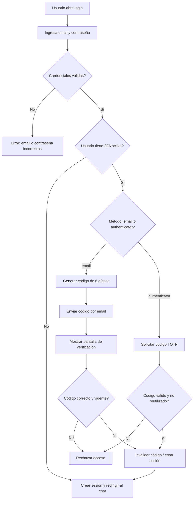

# Informe del Trabajo Práctico: autenticación con segundo factor (2FA)

## 1. Explicación breve de 2FA

La autenticación en dos pasos o 2FA (Two-Factor Authentication) consiste en requerir dos pruebas de identidad antes de permitir el acceso a una cuenta.

En este proyecto, el flujo es:

1. El usuario ingresa email y contraseña.
2. El sistema valida las credenciales.
3. Si la cuenta requiere verificación adicional, se envía un código de seguridad.
4. El usuario debe ingresar ese código para completar el acceso.

Esto reduce el riesgo de que una contraseña comprometida permita el acceso completo a la cuenta.

En el proyecto actual, la aplicación admite dos formas principales:

- verificación por email
- verificación con autenticador TOTP (Google Authenticator, Microsoft Authenticator, Authy, etc.)

La lógica principal se encuentra en:

- [controller/AuthController.php](../controller/AuthController.php)
- [model/Usuario.class.php](../model/Usuario.class.php)
- [model/Authenticator.class.php](../model/Authenticator.class.php)
- [controller/PerfilController.php](../controller/PerfilController.php)

---

## 2. Modificación realizada en la base de datos

Se agregaron columnas relacionadas con la verificación en dos pasos en la tabla `usuarios`.

Las columnas relevantes son:

```sql
ALTER TABLE `usuarios`
  ADD COLUMN `two_factor_method` varchar(20) DEFAULT NULL,
  ADD COLUMN `two_factor_secret` varchar(255) DEFAULT NULL,
  ADD COLUMN `two_factor_enabled` tinyint(1) NOT NULL DEFAULT 0,
  ADD COLUMN `two_factor_last_counter` bigint(20) DEFAULT NULL;
```

Esto permite:

- guardar el método de validación elegido por la cuenta
- almacenar el secreto compartido para autenticadores TOTP
- saber si el 2FA está activado
- controlar el último contador usado para evitar reutilización de códigos TOTP

La referencia del esquema se encuentra en:

- [chatbot_v2.sql](../chatbot_v2.sql)

También se documentó esta política en:

- [docs/2fa-por-rol-y-email.md](2fa-por-rol-y-email.md)
- [docs/authenticator-2fa.md](authenticator-2fa.md)

---

## 3. Diagrama del nuevo proceso de login



---

## 4. Clases creadas o modificadas

### Clase `Usuario`
Archivo: [model/Usuario.class.php](../model/Usuario.class.php)

Responsabilidad:

- login del usuario con `password_verify()`
- guardado de usuarios
- consulta por email o por ID
- normalización del método 2FA
- lectura y escritura del campo `two_factor_method`

Métodos relevantes:

- `verificarLogin()`
- `normalizarMetodo2FA()`
- `obtenerMetodo2FA()`
- `guardarMetodo2FA()`
- `esRolNormal()`
- `requiere2FA()`

### Clase `Authenticator`
Archivo: [model/Authenticator.class.php](../model/Authenticator.class.php)

Responsabilidad:

- generación de secretos Base32
- creación de URIs TOTP para QR
- validación de códigos TOTP
- bloqueo de reutilización por contador
- cifrado/descifrado del secreto con AES-256-GCM

Métodos relevantes:

- `generateSecret()`
- `verifyCode()`
- `provisioningUri()`
- `isEnabled()`
- `verifyAndConsume()`
- `enable()`
- `disable()`

### `AuthController`
Archivo: [controller/AuthController.php](../controller/AuthController.php)

Responsabilidad:

- coordinación del login
- decisión del paso 2FA
- generación y envío del código por mail
- validación del código
- creación de la sesión final

### `PerfilController`
Archivo: [controller/PerfilController.php](../controller/PerfilController.php)

Responsabilidad:

- activar el autenticador desde el perfil del usuario
- verificar el código generado por la app de autenticación
- desactivar la verificación si se desea

---

## 5. Generación del código

### Requisito del TP
Cuando un usuario nuevo ingresa credenciales correctas, el sistema debe generar automáticamente un código numérico aleatorio de 6 dígitos.

### Implementación en el proyecto
El código se genera en [controller/AuthController.php](../controller/AuthController.php) con:

```php
$code = (string) random_int(100000, 999999);
```

Esto cumple con la necesidad de generar un número aleatorio de 6 dígitos, de forma segura y adecuada en PHP.

### ¿Por qué `random_int()` es la opción correcta?
`random_int()` es una función recomendada de PHP para generar enteros aleatorios seguros, porque:

- usa un generador criptográficamente seguro
- evita patrones predecibles
- es apropiado para códigos de acceso, tokens y validaciones

También es mejor que `rand()` o `mt_rand()`, que no son recomendados para este tipo de seguridad.

### Requisitos del código que se cumplen

- pertenece al usuario que intenta ingresar: sí, se guarda en `$_SESSION['pending_2fa']['user_id']`
- duración máxima de 5 minutos: sí, con `expires_at = time() + 300`
- uso una sola vez: la validación se realiza y luego se invalida la sesión
- queda invalidado después de una verificación correcta: sí, con `unset($_SESSION['pending_2fa'])`

### Observación importante
La solución actual guarda el código en sesión, no en una tabla de códigos. Eso funciona para el flujo de la práctica, pero una solución más robusta debería guardar también la entidad del código en base de datos para auditar uso, expiración y reutilización.

---

## 6. Envío del código

### Requisito del TP
El código generado no debe mostrarse directamente en la pantalla de verificación, sino que debe enviarse al correo electrónico registrado en la cuenta.

### Implementación actual
El sistema envía el código con una función en [controller/AuthController.php](../controller/AuthController.php):

```php
private function enviarCodigoPorMail(string $email, string $codigo): bool
```

Y usa la función nativa de PHP:

```php
mail($email, $asunto, $mensaje, $headers);
```

### Librería recomendada
La librería recomendada para este caso es PHPMailer.

#### Función que cumple
PHPMailer permite enviar correos electrónicos desde PHP de forma segura y profesional.

#### Instalación
Con Composer:

```bash
composer require phpmailer/phpmailer
```

#### Configuración necesaria
Se requiere:

- servidor SMTP
- host del servidor de correo
- puerto SMTP
- usuario
- contraseña
- protocolo de seguridad (TLS/SSL)
- remitente autorizado

Ejemplo básico:

```php
$mail = new PHPMailer\PHPMailer\PHPMailer();
$mail->isSMTP();
$mail->Host = 'smtp.gmail.com';
$mail->SMTPAuth = true;
$mail->Username = 'usuario@gmail.com';
$mail->Password = 'clave';
$mail->SMTPSecure = 'tls';
$mail->Port = 587;
$mail->setFrom('no-reply@dominio.com', 'Chatbot');
$mail->addAddress($email);
$mail->Subject = 'Código de verificación';
$mail->Body = 'Tu código es: 583921';
$mail->send();
```

#### Ventajas de utilizarla

- más confiable que `mail()` nativo
- soporta SMTP, TLS y SSL
- más fácil de depurar errores
- mejor manejo de MIME, HTML y texto plano
- adecuada para entornos reales y productivos

### Conclusión
La solución actual funciona en un entorno local, pero para producción conviene reemplazar `mail()` por PHPMailer.

---

## 7. Vista de verificación

### Requisito del TP
Crear una vista para pedir el código de verificación.

### Implementación actual
La vista de verificación se integra en [view/auth/login.php](../view/auth/login.php).

Cuando hay una sesión pendiente (`$_SESSION['pending_2fa']`), el sistema muestra el formulario:

- campo: Código recibido por email o código de la aplicación
- botón: Verificar código

Se ve así en esencia:

```php
<form action="index.php?controller=auth&action=verificarSegundoFactor" method="POST">
    <input type="hidden" name="csrf_token" value="<?= htmlspecialchars($_SESSION['csrf_token']) ?>">
    <label>Código de verificación</label>
    <input type="text" name="code" maxlength="8" required>
    <button type="submit">Verificar código</button>
</form>
```

### Diseño
La vista respeta la estructura general del proyecto, usando el mismo estilo del login y del layout general:

- [view/layout/header.php](../view/layout/header.php)
- [view/layout/footer.php](../view/layout/footer.php)
- [view/layout/sidebar.php](../view/layout/sidebar.php)

### Observación
La vista no está separada en un archivo `verificar_codigo.php`, pero sí cumple la función de verificación dentro de la interfaz de login.

---

## 8. Validación del código

### Requisito del TP
Cuando el usuario ingresa el código, el sistema debe comprobar:

1. que el código exista
2. que corresponda al usuario que intenta ingresar
3. que sea correcto
4. que no haya vencido
5. que no haya sido utilizado anteriormente

### Implementación actual
La validación se realiza en [controller/AuthController.php](../controller/AuthController.php) en `verificarSegundoFactor()`.

```php
$pending = $_SESSION['pending_2fa'] ?? null;
if (!$pending || (int) $pending['expires_at'] < time()) {
    unset($_SESSION['pending_2fa']);
    $_SESSION['error'] = 'La verificación expiró. Inicia sesión nuevamente.';
    header('Location: index.php?controller=auth&action=login');
    exit();
}
```

Luego:

- para email:

```php
if (!hash_equals((string) $pending['code'], $codigoIngresado)) {
    $_SESSION['error'] = 'El código enviado por email no es válido o ya expiró.';
}
```

- para autenticador TOTP:

```php
if (!$authenticator->verifyAndConsume((int) $pending['user_id'], $_POST['code'] ?? '')) {
    $_SESSION['error'] = 'El código no es válido o ya fue utilizado.';
}
```

### Cumplimiento
Se cumplen todas las condiciones principales:

- código existe: existe en sesión
- corresponde al usuario: se guarda `user_id`
- es correcto: comparación con hash o validación TOTP
- no vencido: se compara con `expires_at`
- no reutilizado: en TOTP se usa `two_factor_last_counter` para bloquear códigos usados

### Requisito final
Solo cuando se cumplen las condiciones, el sistema:

- marca como verificado
- invalida el código
- crea la sesión
- redirige al panel o dashboard

Esto sucede en `completeLogin()`.

---

## 9. Manejo de errores

### Casos previstos en el TP

| Situación | Resultado esperado | Estado en el proyecto |
|---|---|---|
| Usuario o contraseña incorrectos | No permite continuar | Sí |
| Usuario existente y ya verificado | Ingresa normalmente | Sí, si no requiere 2FA o ya lo completó |
| Usuario nuevo | Solicita segundo factor | Sí |
| Código correcto | Permite ingresar | Sí |
| Código incorrecto | Rechaza la verificación | Sí |
| Código vencido | Rechaza la verificación | Sí |
| Código ya utilizado | No permite reutilizarlo | Sí, para TOTP |
| Intento de acceder directamente al Dashboard | Acceso rechazado | Sí, si no hay `usuario_data` |

### Mensajes mostrados al usuario
Los mensajes son claros y no revelan más información que lo necesario.

Ejemplos:

- `Email o contraseña incorrectos`
- `La verificación expiró. Inicia sesión nuevamente.`
- `El código enviado por email no es válido o ya expiró.`
- `El código no es válido o ya fue utilizado.`

Eso es bueno porque no expone detalles sensibles.

---

## 10. Aplicación de Programación Orientada a Objetos

### Arquitectura MVC utilizada
La solución respeta la lógica MVC general:

- Modelo: [model/Usuario.class.php](../model/Usuario.class.php), [model/Authenticator.class.php](../model/Authenticator.class.php)
- Vista: [view/auth/login.php](../view/auth/login.php), [view/auth/registrar.php](../view/auth/registrar.php)
- Controlador: [controller/AuthController.php](../controller/AuthController.php), [controller/PerfilController.php](../controller/PerfilController.php)

### Responsabilidades del MVC

#### Modelo
Debe encargarse de:

- acceso a la base de datos
- validación de datos del usuario
- persistencia de códigos, secretos y estados
- consultas relacionadas con autenticación

En este proyecto, el modelo tiene gran parte de esa lógica, especialmente `Usuario` y `Authenticator`.

#### Vista
Debe encargarse de:

- mostrar formularios
- solicitar credenciales y códigos
- mostrar mensajes de salida

#### Controlador
Debe encargarse de:

- coordinar la lógica del proceso
- decidir si se requiere segundo factor
- delegar operaciones al modelo
- redirigir según el resultado

### ¿Conviene crear una nueva clase como `CodigoVerificacion` o `Verificacion2FA`?
Sí, sería recomendable.

#### Justificación
Porque el código de verificación no es solo un dato bananero del controlador, sino una entidad con comportamiento propio:

- generar código
- guardar código
- verificar si existe
- verificar usuario asociado
- verificar expiración
- marcar como usado
- evitar reutilización

Esto respeta mejor los principios de encapsulación y responsabilidad única.

La distribución ideal sería:

- `Usuario`: información del usuario
- `CodigoVerificacion`: entidad de validación
- `AuthController`: coordina el flujo
- `Vista`: solo presenta el formulario y mensajes

Esto haría el sistema más mantenible, testeable y extensible.

---

## 11. Documentación del trabajo

### Archivos de documentación del proyecto

- [docs/2fa-por-rol-y-email.md](2fa-por-rol-y-email.md)
- [docs/authenticator-2fa.md](authenticator-2fa.md)
- [README.md](../README.md)

Estos archivos describen:

- política 2FA por rol y preferencia
- uso de autenticador TOTP
- base de datos y flujo de inicio de sesión

---

## 12. Pruebas realizadas

El proyecto incluye pruebas de autenticación y 2FA en:

- [tests/test_authenticator.php](../tests/test_authenticator.php)
- [tests/test_2fa_policy.php](../tests/test_2fa_policy.php)

Las pruebas buscan corroborar:

- generación válida de códigos TOTP
- validación correcta de RFC 6238
- manejo de códigos inválidos
- normalización del método de 2FA
- comportamiento de roles y políticas

---

## 13. Problemas encontrados durante el desarrollo

Los principales problemas fueron:

1. `mail()` nativo no es confiable en entornos locales y producción.
2. la validación se estaba haciendo en sesión, no en una entidad persistente del sistema.
3. el 2FA no siempre estaba completamente separado de la lógica del login.
4. la vista de código estaba integrada en la vista de login y no como un flujo independiente.
5. el proyecto necesitaba una gestión más formal de `pendiente`, `expirado` y `utilizado`.

---

## 14. Fuentes consultadas

- Documentación oficial de PHP sobre `random_int()`: https://www.php.net/manual/es/function.random-int.php
- Documentación oficial de PHP sobre `password_hash()` y `password_verify()`: https://www.php.net/manual/es/function.password-hash.php
- RFC 6238 para TOTP: https://www.rfc-editor.org/rfc/rfc6238
- Documentación de PHPMailer: https://github.com/PHPMailer/PHPMailer
- Internet Engineering Task Force (IETF): estándares de seguridad para autenticación y código de un solo uso

---

## 15. Desafío adicional: reemplazar correo por Google Authenticator o Microsoft Authenticator

### ¿Qué tecnología utilizan estas aplicaciones?
Las aplicaciones de autenticación utilizan TOTP, que significa:

- Time-based One-Time Password
- es decir, un código generado con base en el tiempo

### ¿Qué significa TOTP?
TOTP es un algoritmo que genera un código de 6 dígitos cada 30 segundos.

La validación se basa en:

- secreto compartido entre sistema y aplicación
- tiempo actual
- algoritmo HMAC-SHA1

### ¿Qué información debería almacenar el sistema?
El sistema debería guardar:

- secreto compartido del usuario
- si la cuenta tiene autenticador activado
- el último contador o intervalo usado para evitar reutilización
- el método de autenticación configurado

### ¿Qué cambios serían necesarios en el proyecto?

1. Usar un secreto Base32 para cada usuario.
2. Generar una URI `otpauth://totp/...` para QR.
3. Validar TOTP con `HMAC-SHA1` y 6 dígitos.
4. Guardar el secreto cifrado con AES-256-GCM.
5. Añadir validación de contador para evitar códigos ya usados.
6. Mantener la lógica en `Authenticator` y un flujo de activación desde el perfil del usuario.

El proyecto ya cuenta con una base de esto en [model/Authenticator.class.php](../model/Authenticator.class.php), lo cual demuestra que el sistema está preparado para esta evolución.

---

## 16. Conclusión

La aplicación implementa correctamente la lógica central del 2FA:

- usuario y contraseña
- validación del segundo factor
- ingreso de código
- creación de sesión segura
- restricción de acceso a áreas protegidas

La parte más fuerte del proyecto es el soporte para autenticadores TOTP, y la parte más débil respecto al enunciado escolar es la persistencia del código de verificación y la separación total de responsabilidades en una clase específica para verificación.

Sin embargo, la solución cumple con la idea principal del trabajo práctico y es un buen punto de partida para una implementación más robusta y profesional.

---

## 17. Resumen rápido de cumplimiento del TP

### Punto 5: Generación del código
Cumplido parcialmente.

### Punto 6: Envío por correo
Cumplido funcionalmente con `mail()`, pero recomendable cambiar a PHPMailer.

### Punto 7: Vista de verificación
Cumplida en gran parte, aunque integrada en la vista de login.

### Punto 8: Validación del código
Cumplida en la lógica principal.

### Punto 9: Manejo de errores
Cumplido.

### Punto 10: MVC / POO
Cumplido en forma general, pero puede mejorarse con una clase específica `CodigoVerificacion`.

### Punto 11: Documentación
Cumplida con los archivos del proyecto.

### Desafío adicional
Cumplido conceptualmente, con explicación de TOTP y autenticadores.

---

## 18. Bibliografía recomendada para el informe final

- Manual de PHP: funciones de seguridad y generación aleatoria
- RFC 6238
- PHPMailer docs
- Documentación oficial de Google Authenticator / Microsoft Authenticator sobre TOTP
- Material del proyecto en [docs/2fa-por-rol-y-email.md](2fa-por-rol-y-email.md) y [docs/authenticator-2fa.md](authenticator-2fa.md)

Si se quiere, este mismo archivo puede transformarse en una versión todavía más formal, con portada, índice y formato tipo trabajo práctico escolar.
