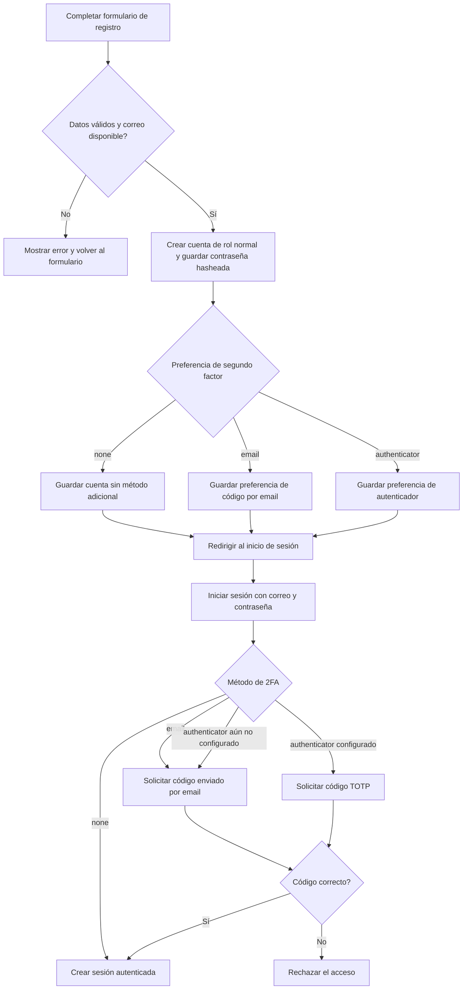
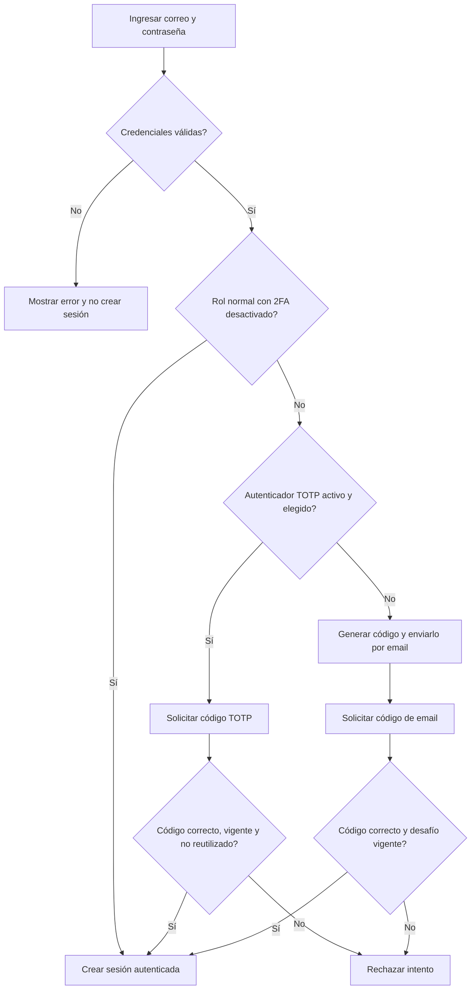

# Trabajo práctico: autenticación con segundo factor (2FA)

**Alumno/a:** ______________________________

**Curso:** _________________________________

**Materia:** _______________________________

**Docente:** _______________________________

**Fecha:** __________________________________

## Introducción

La autenticación en dos factores (2FA, *Two-Factor Authentication*) agrega una comprobación de identidad al inicio de sesión. En esta aplicación, la persona primero ingresa su correo y contraseña. Si su cuenta requiere el segundo factor, debe verificar además un código recibido por correo o generado por una aplicación autenticadora compatible con TOTP. La sesión autenticada se crea únicamente después de completar las comprobaciones correspondientes.

El objetivo de este trabajo es explicar el diseño, el funcionamiento y las pruebas de la autenticación implementada en el chatbot, así como sus limitaciones y posibles mejoras.

## 1. ¿Qué es 2FA?

La autenticación en dos factores solicita dos pruebas distintas para verificar una identidad. En este proyecto, el primer factor es la contraseña. El segundo es un código de un solo uso, entregado por correo electrónico o generado por una aplicación autenticadora.

El segundo factor reduce el riesgo de acceso no autorizado si alguien obtiene una contraseña. No elimina todos los riesgos: por ejemplo, el acceso a la cuenta de correo también puede comprometer un código enviado por ese medio.

## 2. Alcance y política de la aplicación

La aplicación ofrece dos métodos:

- **Correo electrónico:** el servidor genera un código numérico de seis dígitos y lo envía a la dirección asociada con la cuenta.
- **Aplicación autenticadora:** una aplicación compatible genera códigos TOTP de seis dígitos.

La política depende del rol:

- Los roles normales (`Usuario`, `Usuario normal` o `Normal`) pueden iniciar sesión sin segundo factor o usar uno de los métodos. La preferencia se selecciona al registrarse o al editar la cuenta; el perfil permite administrar la configuración TOTP.
- Los demás roles deben completar 2FA en cada inicio de sesión, aunque su preferencia guardada sea `none`. Si su método elegido es `authenticator` y está activado, se solicita el código TOTP; en los demás casos se usa el código por correo.
- Una cuenta sin rol también se trata como una cuenta que requiere 2FA.

La verificación por correo sirve como alternativa cuando no hay un autenticador activo. Para cuentas con direcciones ficticias en pruebas locales, el código se muestra en la consola del navegador al acceder desde localhost. Esta función también se puede activar en desarrollo con `DEBUG_2FA_CODE=true`. No debe habilitarse en producción: quien pueda ver la consola podría obtener el segundo factor.

### Flujo de registro de una cuenta nueva

Una persona que todavía no tiene cuenta puede registrarse desde el enlace **Regístrate** de la pantalla de inicio de sesión. El formulario solicita nombre, correo, contraseña, confirmación de contraseña y una preferencia de segundo factor. La elección de 2FA es opcional para el rol normal que se asigna durante el registro.



El servidor valida que los campos obligatorios estén completos, que ambas contraseñas coincidan y que el correo no esté registrado. Si el alta se completa, guarda la contraseña con `password_hash()`, asigna el rol normal y persiste la preferencia de 2FA cuando se eligió `email` o `authenticator`. Después muestra un mensaje de éxito y redirige a la pantalla de inicio de sesión; el registro no inicia una sesión autenticada automáticamente.

La selección de **Código por email** hace que los inicios de sesión posteriores soliciten un código enviado al correo. Si se selecciona **Autenticador**, la cuenta primero debe completar su inscripción desde **Mi perfil** después de iniciar sesión. Mientras TOTP no esté activado, el inicio de sesión usa el código por email como alternativa; una vez configurado, solicita el código TOTP. Si se elige **No activar**, una cuenta con el rol normal puede iniciar sesión solo con correo y contraseña.

## 3. Flujo de inicio de sesión



En todos los desafíos, el estado pendiente tiene una duración de cinco minutos. La sesión autenticada (`usuario_data`) no se crea hasta completar la verificación requerida. La aplicación regenera el identificador de sesión al iniciar el desafío y nuevamente al autenticar correctamente.

## 4. Componentes del proyecto

### `Usuario` — [model/Usuario.class.php](../model/Usuario.class.php)

Gestiona los datos y las consultas de la cuenta. Verifica la contraseña con `password_verify()`, normaliza el método configurado y determina si el rol requiere 2FA. Los métodos relacionados incluyen `verificarLogin()`, `normalizarMetodo2FA()`, `obtenerMetodo2FA()`, `guardarMetodo2FA()`, `esRolNormal()` y `requiere2FA()`.

### `Authenticator` — [model/Authenticator.class.php](../model/Authenticator.class.php)

Implementa el soporte TOTP: genera secretos, crea la URI de configuración `otpauth://`, verifica códigos y evita volver a aceptar un contador ya utilizado. También cifra el secreto guardado en la base de datos.

### `AuthController` — [controller/AuthController.php](../controller/AuthController.php)

Coordina el inicio de sesión, aplica la política por rol, crea el desafío pendiente, envía el correo, valida el código y crea la sesión autenticada al finalizar.

### `PerfilController` — [controller/PerfilController.php](../controller/PerfilController.php)

Permite iniciar la configuración del autenticador, confirmarla con un código válido y desactivarla con contraseña y código TOTP.

### Vistas

[view/auth/login.php](../view/auth/login.php) muestra tanto el formulario de inicio de sesión como el formulario del segundo factor. [view/perfil/ver.php](../view/perfil/ver.php) permite administrar el autenticador desde el perfil.

## 5. Cambios en la base de datos

La tabla `usuarios`, definida en [chatbot_v2.sql](../chatbot_v2.sql), contiene los campos:

```sql
two_factor_method       varchar(20)  DEFAULT NULL,
two_factor_secret       varchar(255) DEFAULT NULL,
two_factor_enabled      tinyint(1)   NOT NULL DEFAULT 0,
two_factor_last_counter bigint(20)  DEFAULT NULL
```

Sus propósitos son:

- `two_factor_method`: preferencia de método (`email`, `authenticator` o, en la práctica, ninguno).
- `two_factor_secret`: secreto TOTP cifrado.
- `two_factor_enabled`: indica si el autenticador se activó.
- `two_factor_last_counter`: último intervalo TOTP aceptado; evita aceptar nuevamente un código ya consumido.

El archivo SQL prepara una base nueva. En una base existente hay que agregar solo las columnas que todavía no existan; volver a ejecutar un `ALTER TABLE` para columnas ya presentes produce un error.

## 6. Código enviado por correo

Cuando se requiere el método email, `AuthController` genera el código mediante:

```php
$code = (string) random_int(100000, 999999);
```

`random_int()` utiliza una fuente de aleatoriedad criptográficamente segura. El código se asocia con el usuario y el vencimiento en la sesión pendiente, que dura cinco minutos. El envío se realiza con la función nativa `mail()` de PHP.

En una instalación local, `mail()` puede no estar configurado o puede aceptar el envío sin que el mensaje llegue a una dirección ficticia. En ese caso, la aplicación informa que el envío falló y muestra el código de prueba en la interfaz. En localhost también lo registra en la consola del navegador mientras el desafío email está pendiente.

La implementación actual conserva el código en la sesión del servidor hasta que se completa, cancela o vence el desafío. Al verificarlo correctamente, elimina el estado pendiente y crea la sesión. No guarda los códigos email en una tabla ni aplica límite de intentos en esta versión.

Para un despliegue real conviene configurar un servicio SMTP y usar una librería de correo como PHPMailer, con credenciales en variables de entorno. La opción de depuración que muestra códigos debe permanecer desactivada fuera de desarrollo.

## 7. Aplicación autenticadora y TOTP

TOTP (*Time-Based One-Time Password*) genera contraseñas temporales usando un secreto compartido y el tiempo. Esta aplicación usa códigos de seis dígitos con intervalos de 30 segundos y HMAC-SHA1, compatibles con aplicaciones autenticadoras comunes.

El proceso de inscripción es:

1. La persona inicia sesión y confirma su contraseña para comenzar la configuración.
2. El servidor genera un secreto aleatorio codificado en Base32 y lo conserva temporalmente en la sesión.
3. La persona agrega la cuenta a su aplicación escaneando el QR o ingresando la clave manual.
4. Ingresa un código de la aplicación para confirmar que la configuración es correcta.
5. El servidor cifra y guarda el secreto, activa TOTP y almacena el contador aceptado.

Si una cuenta tiene elegido `authenticator` pero todavía no lo activó, el inicio de sesión usa el código por correo. Después de completar el acceso, la aplicación la dirige al perfil para terminar la configuración.

Al iniciar sesión, el servidor tolera el intervalo actual y los intervalos inmediatamente anterior y posterior para compensar pequeñas diferencias de reloj. Solo permite consumir cada contador una vez.

El secreto se cifra con AES-256-GCM. La clave de cifrado se obtiene de la variable de entorno `CHATBOT_TOTP_KEY`, que debe contener una clave Base64 de 32 bytes. Debe mantenerse fuera del repositorio y respaldarse de forma segura: si se pierde o cambia sin migrar los secretos, estos no podrán descifrarse.

Para desactivar TOTP desde el perfil se requieren la contraseña y un código válido del autenticador. Esta versión no implementa códigos de recuperación; si se pierde el dispositivo, se requiere un procedimiento administrativo seguro para recuperar el acceso.

## 8. Validación y manejo de errores

El controlador verifica el vencimiento del desafío antes de validar el código. En el caso email, normaliza el código ingresado y lo compara con el valor pendiente usando `hash_equals()`. En TOTP, `Authenticator::verifyAndConsume()` valida el formato, calcula los contadores permitidos y actualiza el contador en la base de datos de forma condicional para impedir la reutilización concurrente.

| Situación | Comportamiento |
|---|---|
| Email o contraseña incorrectos | Se rechazan las credenciales y no se crea la sesión autenticada. |
| Código incorrecto | Se muestra un error y no se completa el acceso. |
| Desafío vencido | Se elimina el estado pendiente y se solicita iniciar sesión otra vez. |
| Código TOTP ya usado | Se rechaza la verificación. |
| Código email válido | Se elimina el desafío pendiente y se crea la sesión. |
| Envío email fallido | Se informa el problema; en pruebas locales se muestra el código de respaldo. |
| Acceso a una ruta protegida sin sesión autenticada | El enrutador redirige al inicio de sesión. |

Los formularios usan un token CSRF de sesión. Cancelar el desafío elimina su estado pendiente y devuelve a la pantalla de inicio de sesión.

## 9. Arquitectura y programación orientada a objetos

El proyecto utiliza una estructura MVC sencilla:

- **Modelo:** `Usuario` y `Authenticator` encapsulan acceso a datos y operaciones de autenticación.
- **Vista:** los archivos PHP de `view/` muestran formularios y mensajes.
- **Controlador:** `AuthController` y `PerfilController` coordinan las acciones y el flujo de navegación.

El código de email se conserva directamente en la sesión pendiente y el controlador realiza su comparación. Para un sistema más grande se podría extraer el ciclo de vida de esos desafíos a un servicio o clase específica, lo que facilitaría las pruebas, el control de intentos y el almacenamiento centralizado. No es una clase persistente independiente en la implementación actual.

## 10. Pruebas

El proyecto incluye pruebas autónomas:

- [tests/test_authenticator.php](../tests/test_authenticator.php): verifica un vector de referencia de RFC 6238, rechaza códigos inválidos y mal formados, y comprueba el formato de los secretos generados.
- [tests/test_2fa_policy.php](../tests/test_2fa_policy.php): comprueba la clasificación de roles, la obligatoriedad de 2FA para roles no normales y cuentas sin rol, y la normalización de métodos.

Se ejecutan desde la raíz del proyecto con PHP:

```powershell
C:\xampp\php\php.exe tests\test_authenticator.php
C:\xampp\php\php.exe tests\test_2fa_policy.php
```

Estas pruebas comprueban funciones de modelo y algoritmo. No sustituyen pruebas de integración con una base de datos real, servidor SMTP y navegador.

## 11. Limitaciones y mejoras futuras

La solución cumple el flujo principal, pero se puede fortalecer en los siguientes aspectos:

1. Configurar un proveedor SMTP real y mostrar un mensaje de error claro cuando no se pueda entregar el correo.
2. Agregar límites de intentos y demoras progresivas para reducir ataques de fuerza bruta al código email y TOTP.
3. Guardar los códigos email como hash y almacenar su vencimiento y estado de uso, en vez de conservar el valor en la sesión.
4. Evitar mostrar o registrar códigos en cualquier ambiente compartido. En producción, `DEBUG_2FA_CODE` debe estar desactivado y el sitio no debe ejecutarse desde localhost como mecanismo de seguridad.
5. Incorporar códigos de recuperación y un procedimiento auditado de restablecimiento para quien pierda su autenticador.
6. Agregar pruebas de integración para el inicio de sesión, envío de correo, expiración y bloqueo de rutas antes del segundo factor.

## 12. Fuentes consultadas

- PHP Manual, [`random_int()`](https://www.php.net/manual/es/function.random-int.php).
- PHP Manual, [`password_hash()`](https://www.php.net/manual/es/function.password-hash.php) y [`password_verify()`](https://www.php.net/manual/es/function.password-verify.php).
- M'Raihi et al., [RFC 6238: TOTP](https://www.rfc-editor.org/rfc/rfc6238).
- [PHPMailer: documentación y código fuente](https://github.com/PHPMailer/PHPMailer).
- Documentación del proyecto: [política de 2FA por rol](2fa-por-rol-y-email.md) y [configuración del autenticador](authenticator-2fa.md).

## Conclusión

La aplicación implementa el flujo de autenticación en dos pasos con dos alternativas: código por correo y TOTP. La contraseña se verifica antes de iniciar el desafío y la sesión autenticada se crea después de una verificación correcta. La política actual deja opcional el 2FA para el rol normal y lo exige para los demás roles. Si una cuenta privilegiada elige `authenticator` y lo tiene activo, se solicita TOTP; si no, se usa email. Los secretos TOTP se cifran y los contadores usados se registran para evitar reutilización.

La solución es adecuada como implementación funcional del trabajo práctico y cuenta con pruebas unitarias básicas. Para producción todavía necesita correo SMTP confiable, límites de intentos, recuperación de cuentas y pruebas de integración. La visualización de códigos de depuración es exclusivamente para desarrollo local y no debe estar habilitada en un entorno real.
